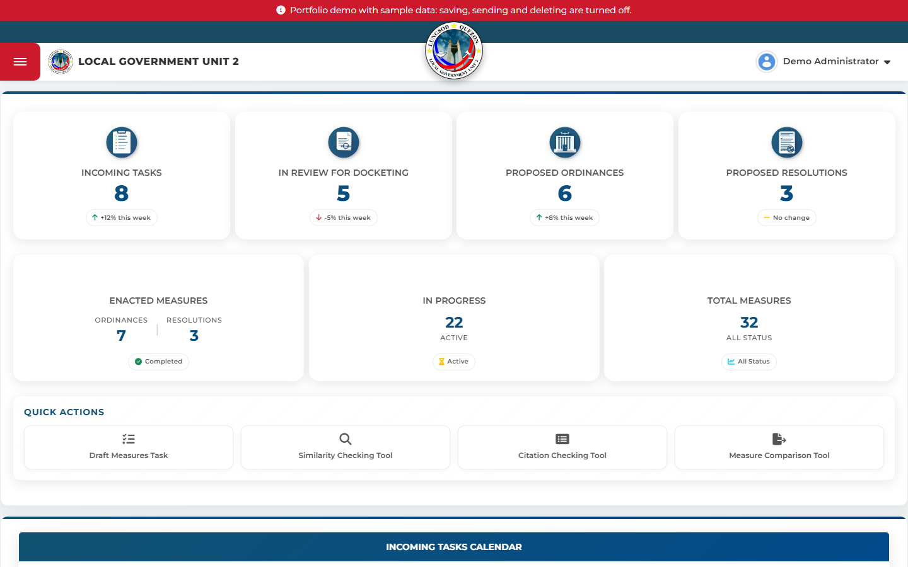
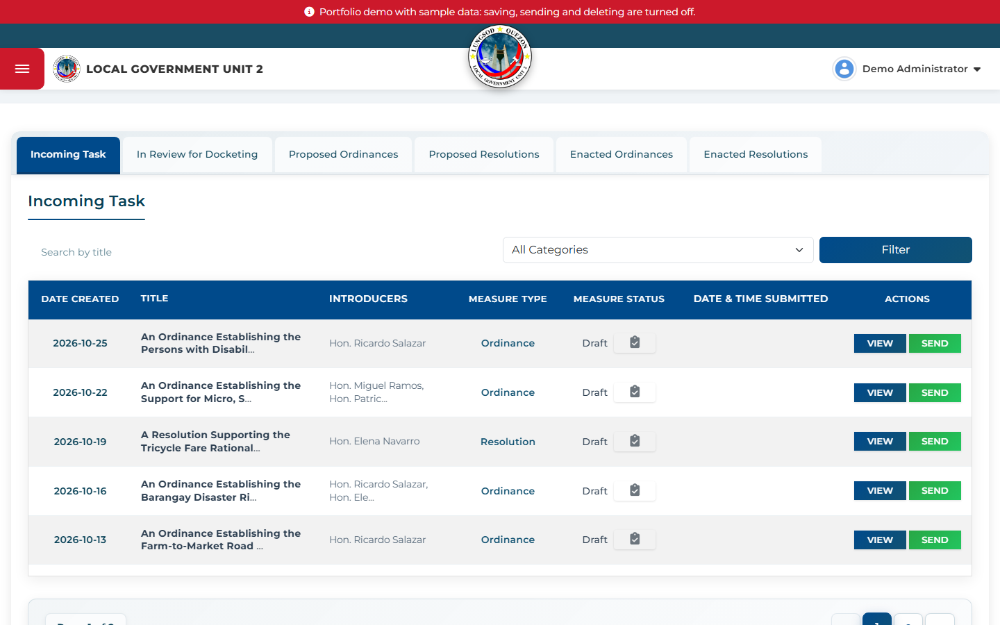
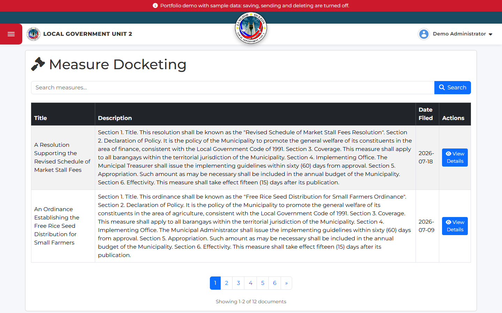
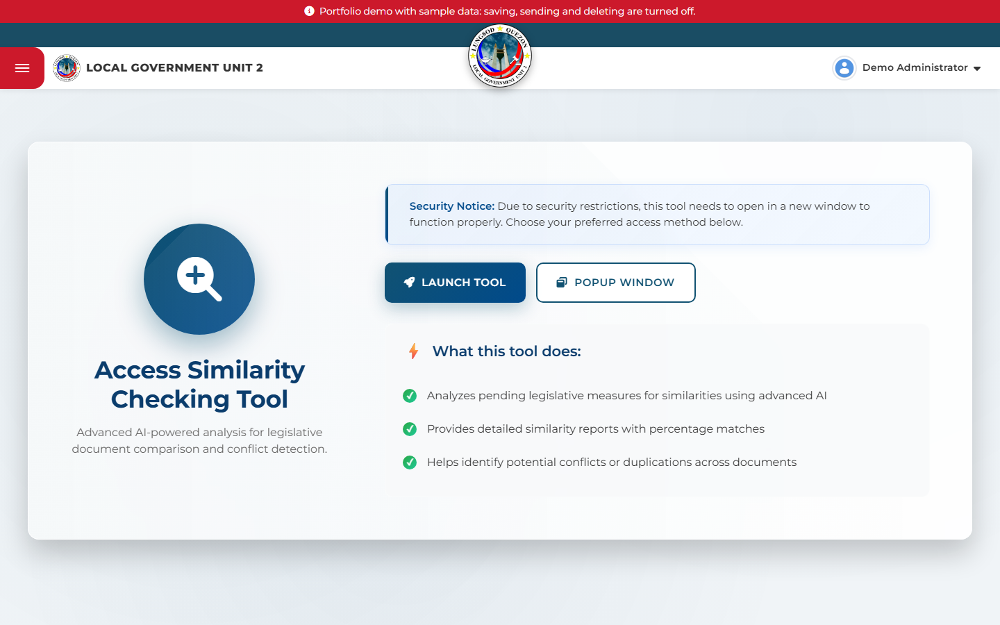
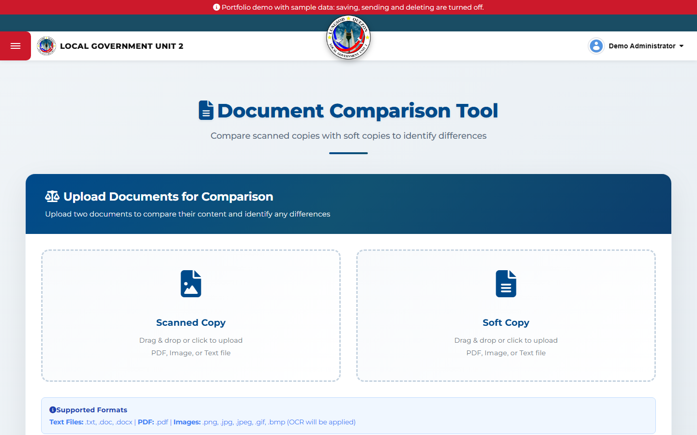
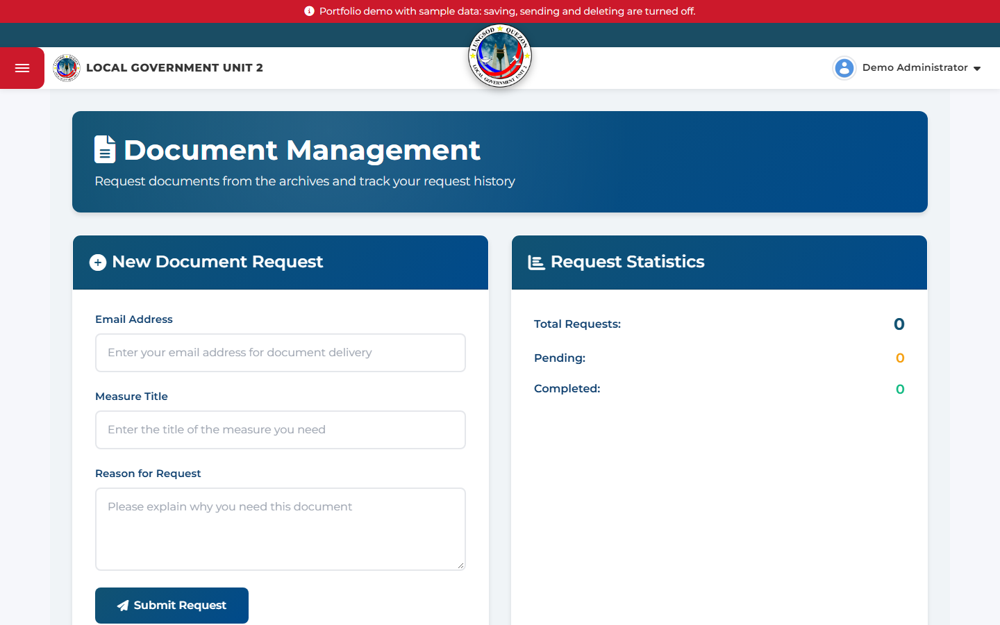
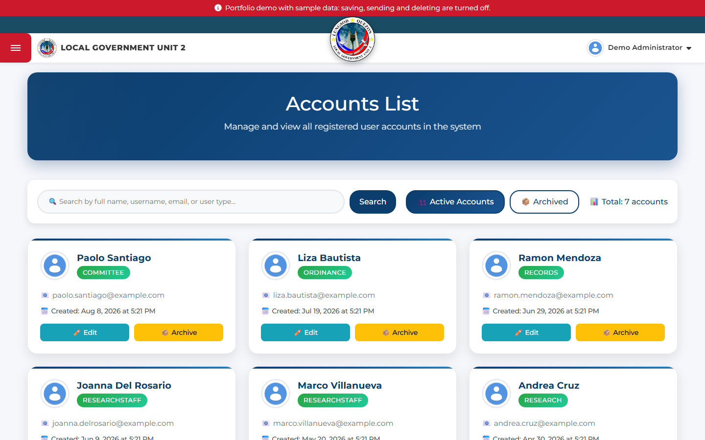

# LGU2 Legislative Research Section

**Capstone project.** A web system for the Legislative Research Section of a local government unit's
legislative council. It tracks every proposed ordinance and resolution from first draft to enactment:
research staff check each measure for duplicates and conflicts with existing laws, review it in three
stages, and send it on for docketing. It is one of nine connected LGU2 systems (Records, Ordinance,
Minutes, Agenda, Committee, Committee Journal, Journal, Archives and Research) that hand measures to each
other through APIs and share a single sign-on.

**[▶ Open the live portfolio demo](https://laurence421.github.io/Local-LGU-Capstone/)**: no login needed,
all data is fictional sample data. Everything in the sidebar works: send a draft measure to Records, add
reviews, filter and page through the tabs, export a PDF, manage accounts, and submit and process document
requests. Your changes stay in your own browser; **Reset demo** in the banner restores the sample data.



## What it does

- **Dashboard** with live counts of measures at each stage, enacted ordinances and resolutions, an
  incoming-tasks calendar and a recent activity feed.
- **Draft Measures Task**: the research workflow. Incoming drafts, measures in review for docketing,
  proposed and enacted ordinances and resolutions, each with a three-stage review trail, automatic
  category detection and PDF export.
- **Similarity, Citation and Measure Comparison tools** to find duplicate or conflicting measures before
  a draft moves forward.
- **Document requests**: the public requests copies of measures; staff approve them and send the
  documents by email.
- **Records and Correspondence**: docketing and tracking of measures received from the research section.
- **User management** with role-based access (admin, research, records, ordinance, committee and more).
- **Super Admin panel** that opens the other eight LGU2 systems through single sign-on.

| Draft measures | Measure docketing |
|---|---|
|  |  |
| **Similarity checking** | **Measure comparison** |
|  |  |
| **Document requests** | **Accounts** |
|  |  |

## How it is built

- **Stack:** PHP 8, MySQL/MariaDB, Bootstrap 5, vanilla JavaScript; PHPMailer for email, TCPDF for PDFs.
- **Security:** email one-time-password login with throttling, password reset with hashed tokens,
  server-side role checks on every page, CSRF and same-origin checks, prepared statements throughout,
  upload type allow-lists, and secrets kept in `.env` instead of code.
- **Integration:** the nine systems exchange measures through API-key-protected JSON endpoints and sign
  users in across systems with short-lived, one-time SSO tokens.
- **Operations:** numbered SQL migrations (`tools/migrate.php`), GitHub Actions deployment, and a demo mode
  with seeded sample data for this portfolio.
- **Design decisions** are written up as architecture decision records in [docs/adr/](docs/adr/README.md).

---

*The rest of this file is for developers running the system.*

## Run it locally (XAMPP)

1. Put the project at `C:\xampp\htdocs\local-lgu-research` and start Apache and MySQL.
2. In phpMyAdmin, create an empty database named `lgu2local`.
3. Copy `.env.example` to `.env` and fill it in (database, mail, SSO secret, API keys).
   Keep `APP_BASE_URL=/local-lgu-research` and `APP_URL=http://localhost/local-lgu-research`.
4. Create the tables and your first admin:

   ```
   C:\xampp\php\php.exe tools\migrate.php
   C:\xampp\php\php.exe tools\create_admin.php yourname you@example.com "Your Name"
   ```

   If your database already has the tables, run `tools\migrate.php --baseline` once first, then `tools\migrate.php`.
5. Open http://localhost/local-lgu-research/.

## Configuration

All settings and secrets live in `.env`, which is never committed and is blocked from the web by
`.htaccess`. Code reads them through `env()` (`config/env.php`). Every page loads `bootstrap.php`
(through `auth.php` on logged-in pages), which provides `db()` / `db_connect()`, `url()`, `e()`,
`require_role()`, the CSRF helpers and the API-key helpers.

| Setting | Used for |
|---|---|
| `APP_BASE_URL`, `APP_URL` | Links inside the app; links in emails (never taken from the request) |
| `DB_*` | This system's database |
| `RECORDS_DB_NAME` | Database read by the Records and Correspondence pages |
| `CLOUD_DB_*` | Remote database for the Data Synchronization page (admins only); leave blank to disable |
| `MAIL_*` | OTP, password reset and document emails |
| `SSO_SECRET`, `SYSTEM_KEY` | SSO with the other LGU2 systems (shared secret; rotate with all teams) |
| `LGU2_API_KEY` | Key RACS and the other systems use for our `receive_*`, `update_*` and sync endpoints, and that we send to RACS |
| `RESEARCH_INBOX_API_KEY`, `SEND_TO_RESEARCH_API_KEY` | `api_research.php` and `send_to_research.php` |

## Database changes

Add a new numbered file to `migrations/` (for example `0003_add_x.sql`) and run `tools/migrate.php`.
Do not edit a migration that has already run anywhere.

## Deploy

`deploy.yml` syncs the code to Hostinger with `rsync`, never touching the server's `.env` or the upload
folders, and then runs the migrations. The server needs its own `.env` (with `APP_ENV=production`,
`APP_DEBUG=false`, `APP_BASE_URL=` empty and `APP_URL=https://lgu.jampzdev.com`) before the first deploy.
GitHub only runs workflows from `.github/workflows/`, so move `deploy.yml` there to enable it.

## Portfolio demo

Two ways to show the system without real data or a login. Both use made-up sample data from
`tools/seed_demo.php` (every name and measure in it is fictional).

**Static demo on GitHub Pages (free, never expires).** `portfolio-demo/` holds every page as HTML plus a
small in-browser backend: `demo-backend.js` (source in `tools/static-demo/`) answers the requests the pages
send to the PHP endpoints, using the sample data in `demo-data.js`, and redraws the pages the server used to
fill in (Draft Measures tabs, Accounts, dashboard counters). Changes are saved in the visitor's browser
(localStorage). `.github/workflows/pages.yml` publishes it: in the GitHub repository, set Settings → Pages →
Source to "GitHub Actions", push, and the site appears at `https://<user>.github.io/<repo>/`.

To rebuild it after changing pages, run the live demo locally (below, with `DEMO_MODE=true`) and:

```
node tools/build_static_demo.js http://localhost/local-lgu-research portfolio-demo
```

It crawls the pages and runs `tools/export_demo_data.php` for the data (set `PHP_BIN` if `php` is not on
your PATH). The export refuses to run outside demo mode, so real records can never be published.

**Live demo on a PHP host (pages and lists work, writes are refused).** Use a separate site (for example a
demo subdomain) with its own empty database, never the real one:

1. Upload the project, copy `.env.demo.example` to `.env` and fill in the demo database.
2. Run `php tools/migrate.php`, then `php tools/seed_demo.php` (it refuses to run unless `DEMO_MODE=true`).
3. Visitors land on the dashboard as a demo admin. Saving, sending, deleting, uploading, syncing, SSO and the
   partner APIs are turned off, and a banner says so.

## Architecture decisions

See [docs/adr/](docs/adr/README.md).
